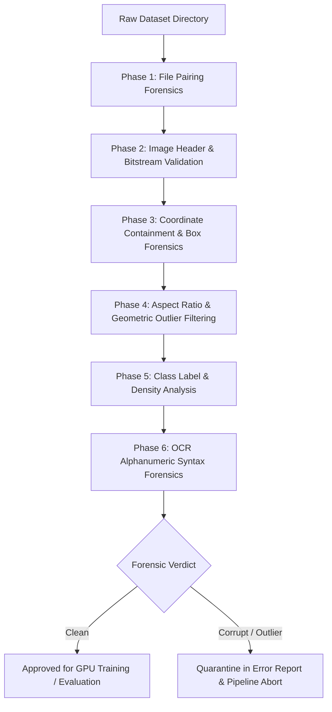

# Dataset Splits and Annotation Forensics

Technical documentation for dataset partitioning, annotation format verification, and automated quality assurance forensics within the **ANPR-CampusGate** system.

---

## 1. System Overview & Dual-Stage Datasets

The ANPR-CampusGate system decouples the recognition challenge into two distinct learning tasks:
1. **Stage 1 (Localization)**: YOLOv8 detector trained on full-frame contextual scenes to isolate vehicle license plates across varying vehicle classes, diagonal approach angles, and illumination shifts.
2. **Stage 2 (Recognition)**: Sequence-to-sequence transformer-based OCR engine (PARSeq / RapidOCR PP-OCR) fine-tuned on cropped, rectified plate regions to decode Indian alphanumeric registration strings.

---

## 2. Dataset Partitioning & Split Methodology

All splits are generated deterministically using pseudo-random seeds (`seed = 42`) to prevent data leakage and ensure evaluation reproducibility across experiments.

### 2.1 YOLOv8 License Plate Detection Dataset

The full-frame detection corpus contains **25,674 images** capturing diverse gate scenes, approach vectors (`ch01` Main Gate 2 lower-right, `ch02` Gate 2 lower-left), and vehicle categories (cars, commercial vehicles, auto-rickshaws, motorcycles, buses).

```
                      ┌──────────────────────────────────────────┐
                      │   Total YOLO Dataset: 25,674 Images      │
                      └────────────────────┬─────────────────────┘
                                           │
         ┌─────────────────────────────────┼────────────────────────────────┐
         ▼                                 ▼                                ▼
┌──────────────────┐             ┌──────────────────┐             ┌──────────────────┐
│   Training Set   │             │  Validation Set  │             │     Test Set     │
│  20,580 Images   │             │   4,116 Images   │             │    978 Images    │
│     (80.16%)     │             │     (16.03%)     │             │     (3.81%)      │
└──────────────────┘             └──────────────────┘             └──────────────────┘
```

#### Split Breakdown

| Dataset Split | Image Count | Percentage (%) | Annotations Count | Mean Annotations / Image | Primary Objective |
|---|---|---|---|---|---|
| **Train** | 20,580 | 80.16% | 21,403 | 1.04 | Model parameter convergence & feature extraction |
| **Validation** | 4,116 | 16.03% | 4,281 | 1.04 | Hyperparameter tuning & early stopping trigger (patience: 20) |
| **Test** | 978 | 3.81% | 1,017 | 1.04 | Unbiased offline benchmark ($mAP_{50} / mAP_{50-95}$) |
| **Total** | **25,674** | **100.0%** | **26,701** | **1.04** | Complete Detection Corpus |

* **Zero-Copy Symlink Management**: The dataset preparation engine (`training/prepare_dataset.py`) links validation samples using filesystem symbolic links rather than duplicating disk contents.

---

### 2.2 Plate OCR Recognition Dataset (`OCR_data/`)

For character recognition, the system maintains a dedicated corpus of **3,767 labeled cropped license plate images** (`OCR_data/images/` and `OCR_data/lables/`).

```
                     ┌──────────────────────────────────────────┐
                     │   Total OCR Plate Crops: 3,767 Samples   │
                     └────────────────────┬─────────────────────┘
                                          │
         ┌────────────────────────────────┼────────────────────────────────┐
         ▼                                ▼                                ▼
┌──────────────────┐            ┌──────────────────┐             ┌──────────────────┐
│   Training Set   │            │  Validation Set  │             │     Test Set     │
│   2,636 Crops    │            │    565 Crops     │             │    566 Crops     │
│      (70%)       │            │      (15%)       │             │      (15%)       │
└──────────────────┘            └──────────────────┘             └──────────────────┘
```

- **Resolution Standardization**: All plate crops are resized to a fixed aspect grid of $32 \times 128 \times 3$ ($H \times W \times C$) before sequence recognition.
- **Split Independence**: The validation and test sets remain on clean, unaugmented normalization transforms ($\mu = 0.5, \sigma = 0.5$), while training crops receive photometric and degradation transforms to simulate night glare and sensor noise.

---

## 3. Annotation Specifications

### 3.1 YOLOv8 Detection Bounding Box Standard

Detection labels are formatted as single-line records per object inside standard UTF-8 text files (`<image_stem>.txt`):

$$\text{Format: } \langle class\_id \rangle \quad \langle x_c \rangle \quad \langle y_c \rangle \quad \langle w \rangle \quad \langle h \rangle$$

Where:
- $class\_id = 0$ corresponds to the mono-class target `license_plate`.
- Coordinates are normalized to $[0.0, 1.0]$ with respect to image dimensions $W_{img}$ and $H_{img}$:

$$x_c = \frac{x_{min} + x_{max}}{2 \cdot W_{img}}, \quad y_c = \frac{y_{min} + y_{max}}{2 \cdot H_{img}}$$

$$w = \frac{x_{max} - x_{min}}{W_{img}}, \quad h = \frac{y_{max} - y_{min}}{H_{img}}$$

### 3.2 OCR Text Ground Truth Standard

OCR annotations conform to Ministry of Road Transport and Highways (MoRTH) standards governing Indian High Security Registration Plates (HSRP):

$$\text{Standard Private / Commercial: } \underbrace{\text{[A-Z]}^2}_{\text{State Code (e.g. UP, DL, MH)}} \quad \underbrace{\text{[0-9]}^{1,2}}_{\text{District RTO Code}} \quad \underbrace{\text{[A-Z]}^{0,3}}_{\text{Series Code}} \quad \underbrace{\text{[0-9]}^4}_{\text{Unique Sequential ID}}$$

$$\text{Bharat Stage (BH) Series: } \underbrace{\text{[0-9]}^2}_{\text{Year of Reg}} \quad \text{BH} \quad \underbrace{\text{[0-9]}^4}_{\text{Sequential ID}} \quad \underbrace{\text{[A-Z]}^{1,2}}_{\text{Series Letters}}$$

---

## 4. Automated Annotation Forensics Architecture

To ensure zero corrupted data passes into GPU training memory, `training/dataset_validator.py` executes a multi-phase forensic audit across all splits:



### Forensic Audit Rules

1. **File-Level Pairing & Orphan Detection**:
   $$S_{\text{missing\_labels}} = \{s \in \text{Stems}(I) \mid s \notin \text{Stems}(L)\}$$
   $$S_{\text{orphan\_labels}} = \{s \in \text{Stems}(L) \mid s \notin \text{Stems}(I)\}$$
   * Orphan labels cause fatal training aborts in YOLO DataLoader workers.
   * Missing labels are quarantined as unannotated frames.

2. **Image Bitstream Integrity**: Decoded via OpenCV in binary read mode to trap truncated bitstreams, invalid EXIF markers, and zero-byte file allocations.

3. **Bounding Box Boundary Checks**:
   $$x_c \in [0.0, 1.0], \quad y_c \in [0.0, 1.0], \quad w \in (0.0, 1.0], \quad h \in (0.0, 1.0]$$
   Absolute boundary verification:
   $$0 \le (x_c - w/2) \cdot W_{img} < (x_c + w/2) \cdot W_{img} \le W_{img}$$
   $$0 \le (y_c - h/2) \cdot H_{img} < (y_c + h/2) \cdot H_{img} \le H_{img}$$

4. **Aspect Ratio Forensics ($AR = w / h$)**:
   - Single-Line HSRP (Cars/Trucks): $AR \in [3.2, 4.5]$.
   - Double-Line / Two-Tier (Motorcycles/Auto-Rickshaws): $AR \in [1.2, 1.8]$.
   - Outlier Rejection: $AR < 0.8$ or $AR > 6.0$ flagged as misannotations.

5. **OCR Character Ambiguity Resolution**:
   - Alphanumeric confusion pairs resolved via slot-based positional repair:
     - $\{O \leftrightarrow 0\}, \{I \leftrightarrow 1\}, \{B \leftrightarrow 8\}, \{Z \leftrightarrow 2\}, \{S \leftrightarrow 5\}$

---

## 5. Augmentation Policy & Restraints

Augmentations are tuned to enhance detector robustness under challenging outdoor gate environments without destroying plate legibility:

- **Mosaic ($p = 1.0$)**: Stitches 4 training images into a single composite frame.
- **MixUp ($p = 0.1$)**: Blends images with linear convex combination.
- **Rotation ($\pm 10^\circ$)**: Simulates camera roll and vehicle pitch.
- **Scale ($[0.85, 1.15]$)**: Simulates vehicle distance variations (5m to 25m from barrier).
- **HSV Jitter ($H \pm 1.5\%, S \pm 30\%, V \pm 30\%$)**: Simulates day/night/glare shifts.
- **Explicitly Disabled**:
  - `flipud: 0.0` (plates are never upside-down).
  - `erasing: 0.0` / `cutout: 0.0` (destructive to small plate character strokes).
  - `shear: 0.0` / `perspective: 0.0` (preserves character stroke legibility).
